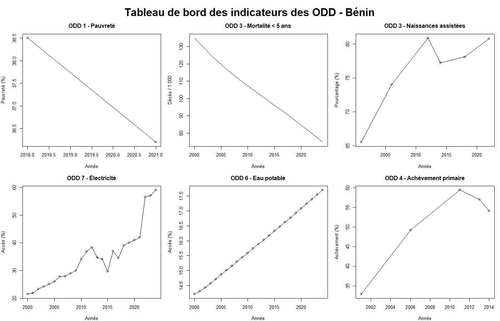

# Benin SDG Dashboard 🇧🇯

## 📊 Statistical Analysis of Sustainable Development Goals in Benin

### 1. Project overview

This project presents a descriptive statistical analysis of selected Sustainable Development Goal (SDG) indicators for Benin.

The objective is to examine the evolution of six key indicators related to poverty, health, education, water and energy access.

The analysis was conducted in R using data extracted from the official United Nations SDG database/API.

### 2. Research question

> How have selected SDG indicators evolved in Benin over the available observation periods?

### 3. Indicators analyzed

| SDG | Indicator | SDG series | Period |
|---|---|---|---|
| SDG 1 | Population living below the national poverty line | `SI_POV_NAHC` | 2018–2021 |
| SDG 3 | Under-five mortality rate | `SH_DYN_MORT` | 2000–2024 |
| SDG 3 | Births attended by skilled health personnel | `SH_STA_BRTC` | 2001–2022 |
| SDG 4 | Primary completion rate | `SE_TOT_CPLR` | 2001–2014 |
| SDG 6 | Population using a basic drinking water service | `SH_H2O_SAFE` | 2000–2024 |
| SDG 7 | Access to electricity | `EG_ACS_ELEC` | 2000–2024 |

### 4. Data source

**United Nations — Sustainable Development Goals Global Database**

Official SDG database:  
https://unstats.un.org/sdgs/dataportal/database

Official SDG API:  
https://unstats.un.org/SDGAPI/swagger/

Country analyzed: **Benin (M49 code: 204)**

### 5. Methodology

The analysis was performed using the following steps:

1. Query the UN SDG API for Benin.
2. Extract the relevant SDG series.
3. Select the appropriate national dimensions for each indicator.
4. Construct clean R data frames.
5. Calculate absolute and relative changes between the first and last available observations.
6. Produce time-series visualizations.
7. Build a summary dashboard.

### 6. Main descriptive results

| Indicator | Initial value | Final value | Absolute change | Relative change |
|---|---:|---:|---:|---:|
| Poverty | 38.50% | 36.20% | -2.30 pp | -5.97% |
| Under-five mortality | 134.97 | 74.75 | -60.22 | -44.62% |
| Skilled birth attendance | 65.50% | 80.80% | +15.30 pp | +23.36% |
| Electricity access | 21.50% | 59.00% | +37.50 pp | +174.42% |
| Drinking water access | 14.21% | 17.70% | +3.49 pp | +24.55% |
| Primary completion | 32.89% | 54.12% | +21.23 pp | +64.54% |

**Note:** `pp` means percentage points. Relative change and percentage-point change are different measures.

### 7. Dashboard



### 8. Key observations

The descriptive analysis shows differentiated changes across the selected indicators.

Between the first and last available observations:

- the poverty indicator decreased;
- the under-five mortality rate decreased;
- skilled birth attendance increased;
- electricity access increased;
- drinking water access increased;
- primary completion increased.

These results describe observed changes in the indicators. They do not, by themselves, establish causal relationships or identify the factors responsible for the observed changes.

### 9. Limitations

The indicators do not all have the same observation periods or frequency.

Some indicators are available annually, while others contain only a limited number of observations. Therefore, comparisons between indicators should be interpreted with caution.

The analysis is descriptive and does not attempt to estimate causal effects.

The current version focuses on national-level indicators. Subnational/communal analysis will be developed separately when sufficiently accessible and comparable data are available.

### 10. Tools and skills

- **R / RStudio**
- Data extraction through API
- Data cleaning and transformation
- Descriptive statistics
- Time-series visualization
- Statistical interpretation
- Data visualization for SDG monitoring
### 11. Feedback and continuous learning

This project is part of my learning journey in data science and statistical analysis.

I am continuously improving my skills in R, data analysis and data visualization. 
Constructive feedback, corrections and suggestions are welcome, particularly regarding:
- statistical methodology;
- R code;
- data visualization;
- interpretation of results.

If you identify an error or have a suggestion for improvement, please feel free to open a GitHub Issue or contact me.

### 12. Project structure

```text
Benin_SDG_Dashboard/
│
├── analyse_sdg_benin.R
├── synthese_odd_benin.csv
├── dashboard_odd_benin.png
└── README.md

### 12. Author
AKITIKPA M.Emmanuella Samandra
Licence en statistique économique et sectorielles-ENEAM,Bénin
Interests: Statistics, Data Science, Sustainable Development, Development Economics and Monitoring & Evaluation.